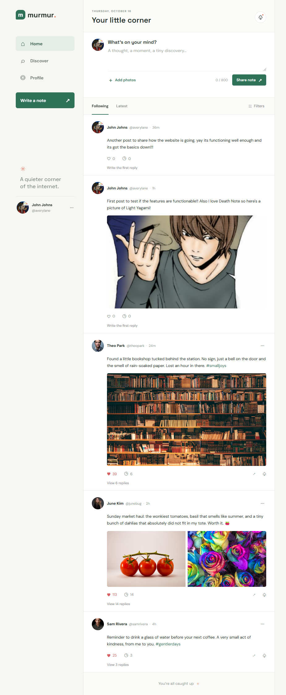
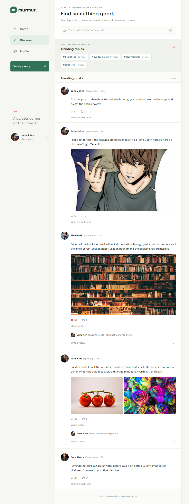

<!-- Assignment 3
RIZE Modern Tech assignment 3, basic website with help of GitHub Copilot.
-->

# Murmur: A Microblogging Website
Murmur is a responsive microblogging website for sharing short notes, photos, and conversations. Discover trending topics, search posts, and explore user profiles.

## Technologies Used <!-- What was used to code the project>
- HTML for page structure and forms.
- CSS for responsive layouts and styling.
- JavaScript for post creation, search, likes, comments, profile editing, and follow controls.
- Browser `localStorage` for saving demo data on the current device.
- Google Fonts and Unsplash images for visual assets.

## How to Run <!-- How the project functions and how to run it>
- Open `index.html` in a modern web browser to view the home feed.
- Use the navigation to open `discover.html`, `profile.html`, and `user-profile.html`.
- No build step or package installation is required.
- Changes are saved in the current browser and are not synced between devices.

## Features <!-- Features that are part of the project>
- Create posts with up to 800 characters and four images.
- Like and comment on posts; new posts appear on the home feed and personal profile.
- Edit a profile’s display name, bio, profile picture, and banner.
- Follow or unfollow users and update follower counts.
- Search posts by keywords and common word forms, with matching text highlighted.
- Browse trending topics and responsive desktop/mobile layouts.

## Images <!-- Images of the project as an website & app>
### Home Feed

### Discover
